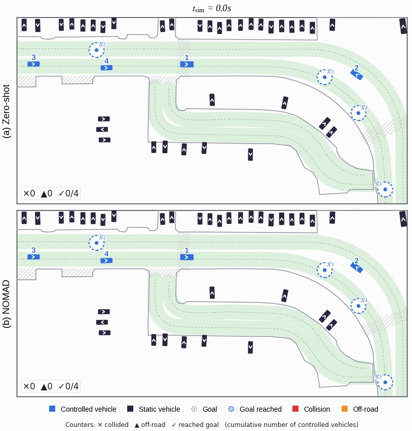

<div align="center">

# Learning to Drive in New Cities Without Human Demonstrations

**NeurIPS 2026**

[](https://zerlinwang.github.io/NOMAD/)
[](https://arxiv.org/abs/2602.15891)
[](https://huggingface.co/datasets/saeedrmd/NOMAD)



</div>

This is the official implementation of **NOMAD** (**NO** data **M**ap-based self-play for **A**utonomous **D**riving), which adapts a driving policy to a new city using only the target-city map and meta-information, without any human demonstrations from that city.
Above: under Singapore-to-Boston transfer, (a) the zero-shot policy keeps driving on the left, causing collisions and off-road events, while (b) NOMAD keeps to the right and all vehicles reach their goals.

## Environment Configuration
### Compile Docker image
```
DOCKER_BUILDKIT=1 docker build --build-arg USE_CUDA=true --tag gpudrive:latest --progress=plain .
```
### Install dependencies
```
# Run Docker container
docker run --gpus all -it --rm --shm-size=20G -v ${PWD}:/workspace gpudrive:latest /bin/bash
# Build gpudrive
mkdir build && cd build
cmake .. -DCMAKE_BUILD_TYPE=Release -DCMAKE_POLICY_VERSION_MINIMUM=3.5 && find external -type f -name "*.tar" -delete
make -j
```
## Dataset Download
NuPlan scenarios (Pittsburgh, Singapore, Boston) are available as the [NOMAD dataset](https://huggingface.co/datasets/saeedrmd/NOMAD) on Hugging Face.

## Data Preparation
The training pipeline consumes GPUDrive-format JSON scenarios. Two preparation
stages turn raw nuPlan logs into the clean subset used in our experiments:

### 1. Convert nuPlan → GPUDrive JSON (`conversion/`)
```
export NUPLAN_DATA_ROOT=/path/to/nuplan/dataset   # directory with .db files
export NUPLAN_MAPS_ROOT=/path/to/nuplan/maps

cd conversion
make nuplan
scenariomax-convert \
    --nuplan_src $NUPLAN_DATA_ROOT \
    --dst /path/to/output \
    --target_format gpudrive \
    --num_workers 16 \
    --nuplan_scenario_duration 15.0
```
See `conversion/README.md` and `conversion/docs/DATASETS.md` for the full schema and CLI options.

### 2. Filter to valid scenarios (`filtering/`)
A scenario is kept only if it has no off-road incidents, runs for more than 5
simulation steps, and contains at least one controllable agent.
```
# Run the combined filter -- emits valid_scenarios_only_<folder>.json under ./output/
python -m filtering.scenarios_valid_filter <data_path> <max_files>

# Copy the valid scenario files into a clean directory
python -m filtering.copy_filtered_scenarios
```

## Training
### Demonstration Generation
```
python baselines/bc/collect_multi_discrete_demo.py
```
### Imitation Learning
```
python baselines/bc/bc.py
```
### Scenario Generation
```
python baselines/goal/generate_scene_heuristic_modular.py
```
### Reinforcement Learning
```
python baselines/bcsp/ppo_finetuning.py
```
## WOSAC Evaluation
```
python baselines/eval/wosac_evaluate.py
```

## Project Page
The source of the [project page](https://zerlinwang.github.io/NOMAD/) lives in [`docs/`](docs/) and is served with GitHub Pages.

---
If you find this repo helpful, don't forget to give us a star!
If this repo helps your research, please cite this work:
```
@inproceedings{wang2026learning,
  title={Learning to Drive in New Cities Without Human Demonstrations},
  author={Wang, Zilin and Rahmani, Saeed and Cornelisse, Daphne and Sarkar, Bidipta and Goldie, Alexander David and Foerster, Jakob Nicolaus and Whiteson, Shimon},
  booktitle={Advances in Neural Information Processing Systems},
  year={2026}
}

@inproceedings{kazemkhani2025gpudrive,
      title={GPUDrive: Data-driven, multi-agent driving simulation at 1 million FPS},
      author={Saman Kazemkhani and Aarav Pandya and Daphne Cornelisse and Brennan Shacklett and Eugene Vinitsky},
      booktitle={Proceedings of the International Conference on Learning Representations (ICLR)},
      year={2025},
      url={https://arxiv.org/abs/2408.01584},
      eprint={2408.01584},
      archivePrefix={arXiv},
      primaryClass={cs.AI},
}
```
